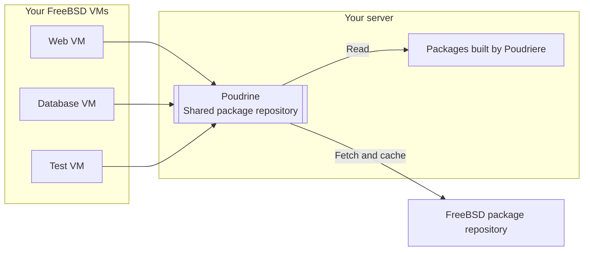
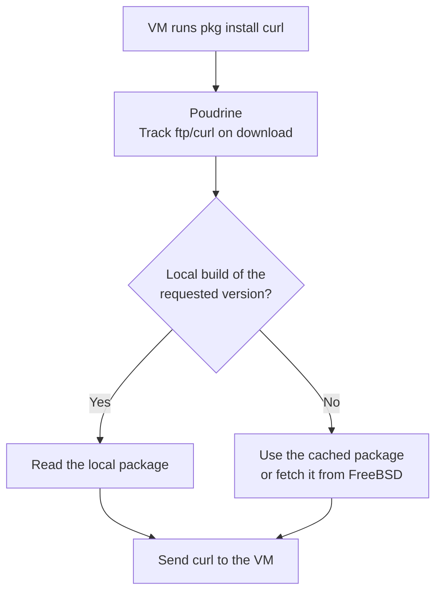
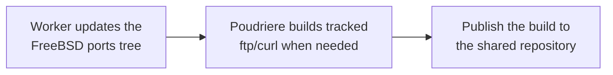

# Poudrine

Point your FreeBSD VMs at one Poudrine repository on your **trusted LAN or private VPN**. Every VM uses the same address for `pkg install` and `pkg upgrade`. Behind that address, Poudrine combines packages built on your server with packages from FreeBSD.



## What happens when a VM runs `pkg install curl`?

The VM asks for the version in Poudrine’s catalog. When both sources have `curl`, the catalog offers the newer version and prefers the local build on a tie. The first VM that needs the FreeBSD package fills the shared download cache for the others.



### How curl stays up to date

`ftp/curl` is the port that builds the `curl` package. Once tracked, it stays on the worker’s build list even if no VM requests it again.



If the ports tree gets a newer `curl` first, Poudrine can publish it while unrelated packages are still building. Once `curl` and its package dependencies are available, every VM can pick it up on its next `pkg upgrade`. By default, the next ports update is due 15 minutes after the previous scheduled run finishes. Poudrine checks FreeBSD’s package catalog every five minutes.

## Security and network placement

**Keep the package repository and Management off the public Internet.** Package downloads and the first inventory report from each client address rely on your network access controls. A malicious or misconfigured client can request or report a large part of the ports tree. That can consume build time, CPU, disk space and upstream bandwidth long after the request finishes. The download cache limit covers cached archives only. Jail storage, distfiles, dependency builds and the local package repository can all grow independently.

- Bind the repository to a LAN or VPN interface and restrict its port to trusted client addresses with your firewall. Bind the website and Management to loopback or an administrator-only network. The default IPv6 addresses `[::]:8080` and `[::]:8181` listen on **every IPv6 interface**, including globally reachable ones. Configure the listeners **before the first start**.
- **The repository signing key lives in the network-facing process.** The same service process handles package requests, serves the website and signs the merged catalog. It holds the private key in memory and can read `repository.key` in its state directory. Compromise of that process or its service account lets an attacker sign a malicious catalog pointing clients at packages they would trust. Protect the host and its backups. After a signing-key compromise, restore a trusted server, rotate the key and replace the trusted public key on every client through a trusted channel.
- The privileged Poudriere worker has its own build signing key and root-controlled directories. Management uses a separate Ed25519 administrator key. Its private half stays with the administrator, and the browser signs each management request. This protects management operations. Ordinary repository clients can still add build work without an administrator signature.
- Client inventory is self-reported. The first accepted report pins the client’s Ed25519 public key to its observed IP. Later reports from that IP require the same key. Keep the report key across reinstalls. Clients behind one NAT share an observed address, so use distinct LAN or VPN addresses for independent reports. Use a trusted host audit when you need to verify what a client runs. A direct HTTP repository sends package names, versions and origins in cleartext. Use a private VPN or a restricted HTTPS reverse proxy for confidentiality on shared networks.

## Run on FreeBSD

Use a FreeBSD RELEASE host that can create jails and reach the upstream FreeBSD package and ports servers. Allow storage for the jail, ports checkout, distfiles, build directories and published packages.

### 1. Install the binary

On a FreeBSD/amd64 server, download and extract the latest binary archive, then run `make install` as root. To choose a specific version, visit [GitHub Releases](https://github.com/inkeliz/poudrine/releases).

```sh
fetch -o poudrine-freebsd-amd64.tar.gz https://github.com/inkeliz/poudrine/releases/latest/download/poudrine-freebsd-amd64.tar.gz
tar -xzf poudrine-freebsd-amd64.tar.gz
cd poudrine
make install
```

To compile on FreeBSD, install Go 1.26 or later with `pkg install go`. Use a Git checkout or extract the latest source archive. In the directory containing `go.mod`, `make install` builds the binaries from the current source before installing them. To compile as an ordinary user, run `make build`, then run `make install-built` as root from the same directory. The main binary embeds the website and uses SQLite without CGO. [Download the source archive](https://github.com/inkeliz/poudrine/releases/latest/download/poudrine-src.tar.gz)

### 2. Bind the service to your network

As root, create `/usr/local/etc/poudrine.json`. In this example, `fd42:10::20` is the server’s private LAN address and `pkg.home.arpa` resolves to it on every client. Substitute an address assigned to your server and your own LAN DNS name. Set `repo_url` to the full address clients will use, including the repository port.

```json
{
  "repo_listen": "[fd42:10::20]:8080",
  "repo_url": "http://pkg.home.arpa:8080",
  "web_listen": "[::1]:8181"
}
```

An IPv4 LAN can use a listener such as `192.168.10.20:8080`. For a single machine or access over SSH tunnels, the [bundled configuration](examples/poudrine.json) binds both listeners to IPv6 loopback. A port alone, such as `"9080"`, binds all IPv6 interfaces. Keep the configuration file and its parent directory root-controlled. For a different file location, set `sysrc poudrine_config=/path/to/poudrine.json` and use that path for the commands below.

```sh
poudrine check-config -config /usr/local/etc/poudrine.json
sysrc poudrine_enable=YES
service poudrine start
service poudrine status
```

On the first start Poudrine creates the `_poudrine` service account, installs missing Poudriere and Git packages, generates signing and website keys, and provisions a non-ZFS build jail and ports tree. An upgrade from the old rc.conf-based version imports the previous options once when the JSON file is missing. The website can become available before the first catalog. Repository metadata returns HTTP 503 until Poudrine has a verified catalog to serve. Check `/var/log/messages` for provisioning or catalog errors. To disable automatic startup, use `sysrc poudrine_enable=NO`.

### 3. Connect to the website and enroll the administrator

From your workstation, forward the loopback website port over SSH. Open `https://localhost:8181/` through the tunnel.

```sh
ssh -N -L '8181:[::1]:8181' admin@buildhost
```

On the server console or through trusted SSH, run these commands as root. Compare the SHA-256 fingerprint with the self-signed certificate shown by your browser before trusting the website or copying client setup commands.

```sh
openssl x509 -in /var/db/poudrine/web-tls.crt -noout -sha256 -fingerprint
cat /usr/local/etc/poudrine.json.setup-token
```

1. Open **Management** and enter the one-time token. The browser creates an Ed25519 administrator key. Save the **entire private key**, including the PEM header and footer, in your password manager or a private backup.
2. Choose **I’ve saved my key · Sign in**, then paste or autofill the key in the password box. If your password manager asks for a username, use `admin`. Poudrine signs requests in the browser and stores the public key in `<config>.admin.pub`.
3. Open **Service settings → Network** and check the prefilled **Package repository URL** from a client’s point of view. Choose **Done** to keep the defaults or **Save settings** to apply edits. Automatic values continue to follow the host and configuration until you override them.

## Connect a FreeBSD client

On the Poudrine website, open **Client setup** and select **Copy setup commands**. Paste the script into a root `sh` shell on the FreeBSD client. It registers Poudrine for ports packages and installs its public signing key. FreeBSD continues to provide OS updates.

```sh
# pkg upgrade -f  # Optional. Reinstall installed packages after switching repositories.
```

## Operate the service

### Builds and inventory

Poudrine checks the FreeBSD metadata every five minutes by default. When the mirror supports conditional HTTP requests, an unchanged signed catalog can be revalidated without downloading the archive again. Changed metadata still requires signature verification before publication. If a check fails, Poudrine retries within a minute.

**Build activity** shows overall progress and the next scheduled run or retry. Below it, **Running packages** updates live as builders start and finish. Each row shows the package, its current phase and elapsed time, including working-hours pauses. A percentage appears when the build tool reports progress within its current phase. CPU and resident memory are summed across the builder’s jail processes. CPU usage of 100% represents one core.

**Run build now** updates the jail and ports tree and starts an incremental bulk build. **Queue next build** reserves one follow-up while a build is active. With no tracked origins, the worker still updates the jail and ports tree. Between scheduled runs it checks for changes to the tracked origins every 30 seconds.

Open **Build activity → Failed and skipped packages** to see which package failed, the build phase and the packages it blocked. For example, if `devel/abseil` fails during `fetch`, open **View log** on its row to see Poudriere’s fetch output. The skipped `misc/codex` and `devel/protobuf` packages appear underneath. **Load earlier output** reads back to the beginning of the package log. The run selector lets you inspect earlier failures while another build is running.

Open **View log** beside a running package to follow its output with **Refresh latest output**. Completed packages also have a log link in the recent build history.

Choose **Retry with dependents** to queue that group, or **Retry all affected packages** for the selected run. The worker starts a fresh incremental Poudriere run in the configured working hours, after any active build finishes. It reuses healthy archives and builds missing packages locally. Diagnosis uses the retained files under `<basefs>/data/logs/bulk/<jail>-<ports>/<run>/`; the web service account needs read access there. Retrying requires the supervised service.

**Build history** counts packages by the UTC hour, day, week or month they finished. A run that builds 20 packages contributes 20 completions, and the chart shows failed package attempts separately. Expand **Recent package builds** to see the last 20 results in the selected period, including package versions and finish times. Poudrine recovers earlier results from retained Poudriere build logs. Fetched, skipped and already up-to-date packages contribute zero.

Enable the bell in Management to receive one notification for each newly built package whose version is higher than its counterpart in the verified FreeBSD catalog. Each notification shows the package and both versions. For example, a local `nginx` build at `1.28.0_2` qualifies when FreeBSD has `1.28.0_1`. Poudrine retries temporary delivery failures for up to seven days after the build finishes.

Under **Management → Service settings → Poudriere builds**, set **Working hours** to run builds when power or compute is cheaper. Enter daily ranges in the server’s local time using a 24-hour clock. For example, `00:00-10:00,11:00-17:00` allows both overnight and solar hours. A range can cross midnight, such as `22:00-06:00`. Leave the field empty for unrestricted builds. When a window closes, running compilers pause in memory. They resume when the next window opens. Keep the server and service running during the pause.

**Parallel package builders** controls how many packages Poudriere builds at once. **Make jobs per package** controls parallel compilation within each package, and **Make jobs limit per package** caps it. For example, two builders with four make jobs each can run up to eight make jobs at once. Ports that require serial builds still run serially.

**Repository clients** shows each IP, its unique package count and its last visit. Select **View packages** to see the names, requested versions and versions in the client’s latest installed-package report. A package that appears in both counts once, even when the versions differ. A client that has only requested catalog metadata can have zero packages.

During a bulk build, Poudrine checks finished archives every 15 seconds. For example, when Firefox finishes building with dav1d 1.5.5 and the repository still offers 1.5.4_1, Poudrine looks for the 1.5.5 package in the worker’s staging directory. Once both archives pass their publication checks, clients can run `pkg update` and install the new versions while other ports are still compiling.

Package inventory labels a locally built archive **Compiled**. A binary dependency the worker obtained from its package repository appears as **Fetched by Poudriere**. Poudrine trusts the worker’s native fetch records and requires the staged archive to match its download cache, the dependency’s identity and the target ABI. Poudrine signs the catalog with the checksum of the bytes it serves. If the newer archive is unavailable, a compatible published dependency can still satisfy Firefox’s declared package and shared-library requirements.

If a required library is missing, Package inventory names it and Poudrine checks again as providers become available. Updates that remove a previously provided library and packages with explicit `dep_formula` expressions wait for Poudriere’s final repository.

At the end of the run Poudrine switches to Poudriere’s committed repository. Budget temporary disk space for one extra copy of the packages published during a build. Poudrine keeps their download URLs for at least 24 hours after the handoff so clients can finish using an earlier catalog. A `local_repo` pointing to a different repository follows that repository’s own publication schedule.

**Package inventory** can be searched by port, package name or full package ID, such as `firefox-161.0,2`. **Build history only** means Poudriere recorded a successful build and the current catalog has no matching compiled archive. The row shows the publication blocker when known, such as an unreadable archive or a missing dependency. After a restart, Poudrine checks the archives still in Poudriere’s staging directory against the native build records. **Compiled** shows the size of an available local archive.

To see which Firefox version clients can install, refresh the signed repository on a client and query it directly.

```sh
pkg update -f -r Poudrine
pkg rquery -r Poudrine '%n-%v' firefox
```

Use **Compiled** for local builds, **Cached** for downloaded archives, or **Different from FreeBSD** for compiled archives whose version differs from FreeBSD’s. After a successful catalog check, Poudrine removes cached copies when a matching local build has the same or a newer version. A newer FreeBSD download stays cached.

Management shows the number and size of compiled archives and cached downloads. **Poudriere disk usage** covers its base directory and distfiles, including packages stored inside the base directory. The worker measures this at startup and every 15 minutes.

**Port version** comes from the latest Poudriere bulk run’s resolved ports list for the configured jail and tree. **Local (FreeBSD)** compares the compiled version with the version in the verified FreeBSD catalog. A dash means the value is unavailable. **Consumers** counts distinct client IPs that requested the package or included a catalog match in their latest report. Repeated downloads from one IP count once. Hover over **Last activity** for the exact date and time.

### Configuration, certificates and upgrades

**Management → Service settings** and manual edits both update `/usr/local/etc/poudrine.json`. An omitted field takes its default. Use lowercase JSON field names, duration strings such as `"15m"`, and numbers for cache size and job counts. Validate a candidate with `poudrine check-config -config /path/to/candidate.json`. Keep it beside the active file when testing relative paths. The supervised service applies working hours to the running build. Settings that require restarting the worker take effect between runs. Invalid edits leave the current service running.

| Settings | Defaults or use |
| --- | --- |
| `repo_listen`, `web_listen` | HTTP `[::]:8080`, HTTPS `[::]:8181`. Set these to your private interfaces or loopback. |
| `repo_url`, `web_url` | Optional advertised addresses. Set `repo_url` to an address resolvable by the clients. Include any port and reverse-proxy path prefix. |
| `web_tls`, `tls_cert`, `tls_key` | HTTPS enabled. Leave both file paths empty to generate a self-signed certificate in the state directory. |
| `state`, `service_user` | `/var/db/poudrine`, `_poudrine`. |
| `upstream`, `fingerprints` | FreeBSD latest for the host's package ABI, `/usr/share/keys/pkg`. |
| `cache_gb`, `refresh` | 5 GB of download cache, five minutes between FreeBSD catalog checks. Completing a build triggers an additional check. To update an installation with an explicit hourly interval, set `refresh` to `"5m"` or change **Catalog refresh interval** in Management. |
| `jail`, `ports`, `jobs`, `build_interval` | `latest`, `main`, six parallel jobs, 15 minutes between scheduled runs. If your configuration already specifies a longer interval, set **Poudriere builds → Build interval** to `15m` in Service settings. |
| `working_hours` | Daily working hours, for example `"22:00-06:00,11:00-17:00"`. Defaults to unrestricted. |
| `make_jobs_number`, `make_jobs_number_limit` | Per-package make job count and cap. Each defaults to `0`, which leaves that override unset. A count or cap above one enables parallel make when the other setting permits it. |
| `local_repo`, `packages_file` | Poudriere’s published package directory and `/usr/local/etc/poudriere.d/packages.txt`. |

- **TLS.** For a certificate issued by your local CA, give the service account read access to the PEM chain and matching unencrypted PEM private key. Run `poudrine set-tls -tls-cert /path/to/fullchain.pem -tls-key /path/to/privkey.pem` as root. Supply `-config /path/to/poudrine.json` after `set-tls` for a custom configuration. Restart after renewing files in place. Use `poudrine set-tls -self-signed` to restore automatic certificates. Verify the fingerprint again after an automatic renewal or hostname change.
- **Private reverse proxy.** Bind backends to loopback, serve clients an HTTPS repository URL and restrict incoming connections to your LAN or VPN. To preserve client attribution, set `trusted_proxy` to the exact proxy address (`/32` or `/128`) and overwrite `X-Real-IP` at that proxy. For a website mounted under a path, include the path in `web_url` and strip the prefix before forwarding.
- **Upgrade during a build.** Install the updated binaries from the new release or checkout using the steps above, then run `service poudrine restart` as root. The service pauses Poudriere and its compilers while the updated web and repository servers start. The same processes then continue the package they were building. A build outside working hours stays paused until its window opens. The supervisor switches to the new binary after the run finishes and carries over queued builds and retries. If you use the optional status reader, run `service poudrine_status restart` separately.
- **First upgrade from an older release.** A supervisor installed before restart support needs one ordinary stop and start. Let the active build finish, then run `service poudrine stop`, `make install`, and `service poudrine start`. The new rc script reports when this one-time step is needed. An explicit stop or a host shutdown still terminates an active build.
- **Move the service.** Stop it before copying its private state directory, including `inventory.sqlite`, `repository.key` and the TLS files. Preserve the state directory’s service-account ownership and mode 0700. Keep the root-owned configuration, `<config>.admin.pub` and worker files, including the worker build signing key. A new state directory creates a new repository signing identity, which requires distributing a new public key to clients.
- **Sign in with a saved browser key.** If you enrolled with an older version, open Management in the original browser profile at the same scheme, hostname and port. Choose **Use saved browser key**.

### Signed management API

API reads use the custom HTTP method `QUERY`. Send arguments in a JSON object and use `{}` for a read without arguments. API URLs reject query strings. Configure any reverse proxy to forward `QUERY`, the body and signature headers. Ordinary page visits and FreeBSD package downloads use standard HTTP.

Management requests use the enrolled administrator’s Ed25519 key. To sign a request, concatenate this UTF-8 prefix and the exact bytes of the body you will send. Each `\n` represents one LF byte. Use the escaped route path as received by Poudrine after any proxy prefix removal.

```text
poudrine-v2\n<METHOD>\n<PATH>\n<UNIX_SECONDS>\n<NONCE>\n
```

| Header | Value |
| --- | --- |
| `X-Poudrine-Time` | Decimal Unix time in seconds, within five minutes of the server clock. |
| `X-Poudrine-Nonce` | Fresh 16-byte random value, unpadded base64url. Reuse of an accepted nonce returns HTTP 409. |
| `X-Poudrine-Signature` | The Ed25519 signature, unpadded base64url. |
| `X-Poudrine-Key` | Raw Ed25519 public key, unpadded base64url. Include it for initial enrollment, client inventory reports and the public statistics API. Management looks up its enrolled key for subsequent requests. |

| Request | Example signed body |
| --- | --- |
| `POST /api/admin/login` | `{}` |
| `QUERY /api/admin/build` | `{}` |
| `QUERY /api/admin/build/events` | `{}` |
| `QUERY /api/admin/build/history` | `{"interval":"day"}` |
| `QUERY /api/admin/build/issues` | `{}` for the latest run with issues, or `{"started":"2026-11-21T02:00:00.123456789Z"}` |
| `QUERY /api/admin/build/log` | `{"started":"2026-11-21T02:00:00.123456789Z","package":"abseil-20250127.1_3"}` |
| `POST /api/admin/build/retry` | `{"started":"2026-11-21T02:00:00.123456789Z","package":"abseil-20250127.1_3"}` |
| `QUERY /api/admin/clients/packages` | `{"ip":"2001:db8::10"}` |
| `POST /api/admin/build/force` | `{}` |

Login returns HTTP 204. Each `build` event contains the full snapshot, starting with the current state when you connect. Sign each reconnection with a fresh nonce. History accepts `hour`, `day`, `week` and `month`. Forcing a build returns HTTP 202 on acceptance and includes `already_queued` in the response. The client report command on the website signs the exact text it posts to the repository’s `/api/inventory` with that client’s own key.

Use the exact `started` value returned by issues or history to select a run. The log query returns the newest output first. Pass its `start` byte offset as `before` to read the preceding chunk. Omit `package` from a retry to queue all the failed and skipped origins for that run.

### Optional public status page

To publish just the package count and the number ahead of FreeBSD, run `sysrc poudrine_status_enable=YES` and `service poudrine_status start` as root. The separate service listens on `[::]:8282` by default and serves public HTML at `/`. For JSON, send `QUERY /status.json` with body `{}` signed by your own Ed25519 key. Any caller can read the public counts this way. Set `poudrine_status_listen` in `rc.conf` to choose another address.

## Development

Run `CGO_ENABLED=0 go test ./...` and `make build` beside `go.mod`. The two commands live in `cmd/poudrine` and `cmd/poudrine-status`. Each embeds its own files from the corresponding directory under `web/`. Run `make dist` to create binary and source archives in `dist/`.

Push a tag such as `v1.2.3` to publish the FreeBSD/amd64 binary archive and the source archive. A tag such as `v1.2.3-rc.1` publishes a prerelease. Branch pushes and pull requests also build both archives. [GitHub Releases](https://github.com/inkeliz/poudrine/releases)

To exercise the HTTP services alone, save the following in `dev.json` and run `./poudrine serve -config ./dev.json` as an ordinary user.

```json
{
  "state": "./dev-state",
  "repo_listen": "[::1]:8080",
  "web_listen": "[::1]:8181"
}
```

Open `https://localhost:8181/`. Standalone mode creates its automatic certificate and enrollment token in `dev-state/`. The full FreeBSD service runs the Poudriere worker and enables manual builds. The `-config` startup option selects the JSON file for `run`, `serve` and `worker`.
