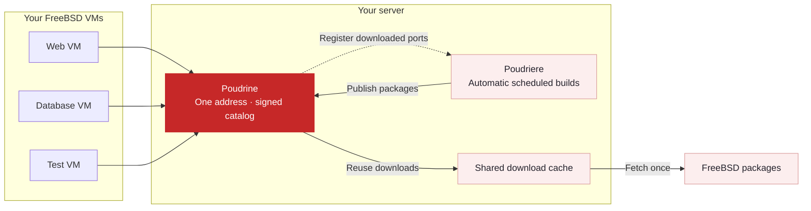
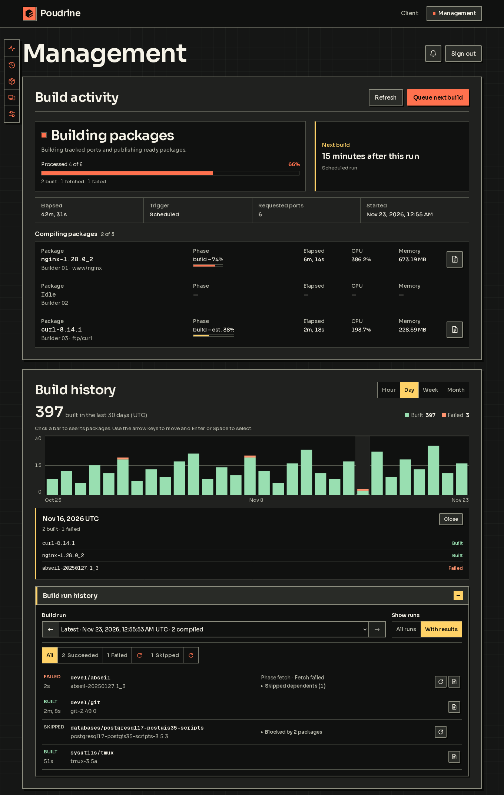

<p align="center">
  
</p>

# Poudrine

Point your FreeBSD VMs at one Poudrine repository on your **trusted LAN or private VPN**. Every VM uses the same address for `pkg install` and `pkg upgrade`. Behind that address, Poudrine combines packages built on your server with packages from FreeBSD.

**One repository. Your builds. Every VM.**

[Get started](#get-started) · [Latest release](https://github.com/inkeliz/poudrine/releases) · [Operations guide](docs/operations.md)

## Why I built it

I built Poudrine to make keeping my servers up to date fast and easy, especially when security patches are available before FreeBSD publishes updated packages.

In one real deployment, Poudrine offered newer versions of **51 out of 301 packages** compared with the FreeBSD repository. For **31 of those packages**, the version distributed by FreeBSD had known security vulnerabilities. That snapshot is why I wanted an easier way to build and deliver updates.

## Why Poudrine?

<table>
  <tr>
    <td width="50%" align="center" valign="middle">
      <br>
      <strong>Single repository</strong>
      <p>One address for local builds and FreeBSD packages. No juggling repository priorities or competing catalogs.</p>
    </td>
    <td width="50%" align="center" valign="middle">
      <br>
      <strong>Faster downloads</strong>
      <p>Download once, share the cache. Ready packages go live with their dependencies while the rest of the build continues.</p>
    </td>
  </tr>
  <tr>
    <td width="50%" align="center" valign="middle">
      <br>
      <strong>Security fixes sooner</strong>
      <p>Build fixes when they reach the ports tree, without waiting for FreeBSD’s next binary package update.</p>
    </td>
    <td width="50%" align="center" valign="middle">
      <br>
      <strong>Build what you use</strong>
      <p>Downloads automatically register ports for future builds. Keep the packages your VMs use up to date, without maintaining a list.</p>
    </td>
  </tr>
  <tr>
    <td width="50%" align="center" valign="middle">
      <br>
      <strong>Customize packages</strong>
      <p>Use per-port overlays to choose build options and dependency versions. Ship packages that fit your setup.</p>
    </td>
    <td width="50%" align="center" valign="middle">
      <br>
      <strong>Dependency inventory</strong>
      <p>See which VMs use each package. Browse client downloads and reported installed versions in one place.</p>
    </td>
  </tr>
  <tr>
    <td width="50%" align="center" valign="middle">
      <br>
      <strong>Build on your schedule</strong>
      <p>Use daytime solar power or quiet overnight hours when the server is idle. Builds pause outside your schedule and resume when it’s time.</p>
    </td>
    <td width="50%" align="center" valign="middle">
      <br>
      <strong>Live build monitoring</strong>
      <p>Follow build progress, inspect logs and retry failed packages with their dependents, all from your browser.</p>
    </td>
  </tr>
</table>

## How it works



Run `pkg install` and `pkg upgrade` as usual. Poudrine offers the newer package from your local builds or FreeBSD, preferring local builds on a tie. FreeBSD downloads are cached for your other VMs.

In the background, Poudriere builds tracked ports and publishes ready packages as their dependencies become available. Packages with custom build options use matching local builds only.



*Management dashboard with example data.*

## Get started

Use a **FreeBSD/amd64 RELEASE host** with jail support and space for ports, builds and packages. Run the server commands below as **root in a `sh` shell** on a fresh installation.

### 1. Install

```sh
fetch -o poudrine-freebsd-amd64.tar.gz https://github.com/inkeliz/poudrine/releases/latest/download/poudrine-freebsd-amd64.tar.gz
tar -xzf poudrine-freebsd-amd64.tar.gz
cd poudrine
make install
```

### 2. Start the service

```sh
sysrc poudrine_enable=YES
service poudrine start
service poudrine status
```

Poudrine starts automatically at boot and listens on IPv6 by default: **8080** for packages and **8181** for the website. Initial jail and ports setup can take a while; the website may open before packages are ready.

### 3. Open the website

In your browser, visit `https://[SERVER_IPV6]:8181/`, replacing `SERVER_IPV6` with your server’s IPv6 address and keeping the brackets. You can also use `https://buildhost:8181/` if that hostname resolves to the server’s IPv6 address.

Alternatively, open an **SSH tunnel from your workstation**. Replace `admin` with your SSH username and `SERVER_IPV6` with the server’s IPv6 address:

```sh
ssh -6 -N -L '8181:[::1]:8181' admin@SERVER_IPV6
```

Leave that terminal open, then visit **[https://localhost:8181/](https://localhost:8181/)**. Do not put brackets around the IPv6 address after `admin@`.

On the **server**, display the website certificate fingerprint and your one-time setup token:

```sh
openssl x509 -in /var/db/poudrine/web-tls.crt -noout -sha256 -fingerprint
cat /usr/local/etc/poudrine.json.setup-token
```

Compare the certificate’s SHA-256 fingerprint with the server output before accepting the self-signed certificate.

### 4. Create your administrator key

1. On the website, click the **Management** tab.
2. Paste the setup token and click **Create administrator key**.
3. Click **Copy private key** and save the entire key in your password manager, including its PEM header and footer. This is your sign-in credential.
4. Click **I’ve saved my key · Sign in**, then paste the saved key to sign in.
5. Check the **Package repository URL** in the setup screen and choose **Done**, or **Save settings** if you changed it.

### 5. Connect your VMs

Click the website’s **Client setup** tab, then **Copy setup commands**. Paste them into a **root `sh` shell on each FreeBSD VM**. You can then use `pkg install` and `pkg upgrade` as usual. FreeBSD continues to provide OS updates.

See the [installation guide](docs/installation.md) for custom listeners, SSH access and source builds.

## Operate the service

Use **Management** to monitor builds, browse package inventory and see client activity. Open **Service settings → Poudriere builds** to customize packages, set working hours and adjust parallel builds.

- **Troubleshoot:** inspect build logs and retry failed packages with their dependents.
- **Upgrade:** install the new binaries, then run `service poudrine restart`. Supported supervisors preserve the active build; older installations need a one-time stop/start.
- **Configure:** edit settings in Management or `/usr/local/etc/poudrine.json`.

See the [operations guide](docs/operations.md) for package overlays, configuration, upgrades and the signed API.

## Security

**Keep the repository and Management on a trusted LAN or private VPN.** Defaults bind all IPv6 interfaces. Restrict access with a firewall; ordinary clients can trigger resource-intensive build work.

The network-facing service holds the repository signing key. Protect its host and backups, save your administrator key securely, and use a VPN or restricted HTTPS proxy for confidentiality. Client inventory is self-reported; the download cache limit does not limit build storage.

Read the [security guide](docs/security.md) for key recovery, client identity and network placement.

## Development

Run `make test` and `make build` on FreeBSD. See the [development guide](docs/development.md) for local setup, FreeBSD integration tests and releases.
